<p align="center">
  
</p>

# Bytescape

See what is eating your disk, and clean it up safely. Bytescape scans a folder or a whole drive, draws it as a treemap, and lets you send the big stuff to Trash without leaving the app.

## Features

- **Treemap and simple view.** Drill into any folder; sizes update live while the scan runs.
- **Fast scans, honest sizes.** Directory listing runs on worker threads; about two million files take a minute. Sizes are space on disk, and on macOS a scan of `/` counts firmlinked folders once.
- **Safe cleanup.** Old node_modules, git-ignored build output and tool caches (Xcode, Gradle, npm, Homebrew, pip) are pre-selected. Duplicates (confirmed byte for byte), old archives and logs are listed for you to review. App data, hidden folders and cloud-synced folders are never suggested. Move to Trash has a 6 second undo, and the treemap, folder sizes and totals update the moment you click.
- **Breakdown by file type.** Find every video, disk image or archive across the scan.
- **For agents.** An optional read-only MCP endpoint lets AI tools ask what is using your space.
- **Private.** Everything runs locally. Scanning is read-only, and nothing about your files leaves your machine.

## Download

Get the latest build from [Releases](https://github.com/arshtepe/bytescape/releases):

| Platform | File |
| --- | --- |
| macOS (Apple Silicon) | `Bytescape-<version>-arm64.dmg` |
| Windows (x64) | `Bytescape-<version>.exe` (portable, no install) |
| Linux (x64) | `Bytescape-<version>.AppImage` or `.tar.gz` |

The builds are not signed yet:

- **macOS** blocks the first launch. Right-click the app and choose **Open**, or run `xattr -dr com.apple.quarantine /Applications/Bytescape.app`.
- **Windows** SmartScreen may warn: choose **More info**, then **Run anyway**.
- **Linux**: make the AppImage executable with `chmod +x Bytescape-*.AppImage`.

## Build from source

Requires Node.js 18 or newer.

```sh
npm install
npm run electron:dev   # run the desktop app
npm run dist:mac       # or dist:win, dist:linux
```

To use it in a browser instead, run `npm run build && npm start` and open `http://127.0.0.1:5178`.

## License

MIT
